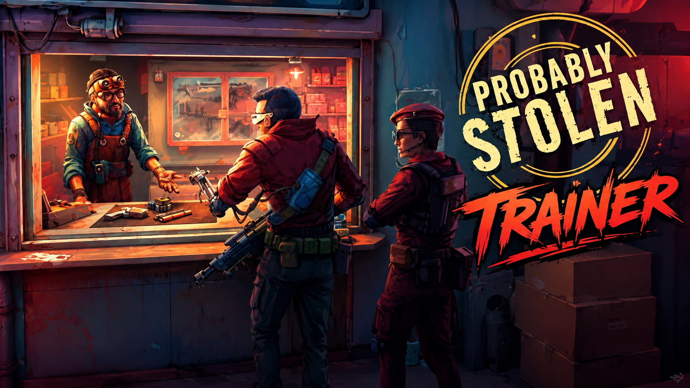

# Probably Stolen — Trainer

**Freeze the rent clock, set credits, grade every item instantly, unlock all 10 specializations, respec perks, skip the night scavenge.**
Free, open source, no installer. Opens with `Insert`.

> **[⬇️ Download the latest Probably Stolen trainer](../../releases/latest)**

    

[Hotkeys](#hotkeys) · [Specializations](#which-option-each-start-actually-wants) · [FAQ](#faq)

---

> [!NOTE]
> Single-player only. No multiplayer, no leaderboards, no anti-cheat. Nothing in this menu reaches another person's shop.

## The one thing this trainer will not do

There is no option here that tells you who is standing at your counter.

That is not an oversight and it is not a limitation. Every customer in Probably Stolen is a judgement call — undercover station security, a wanted name with a bounty on it, a revolutionary who will remember you, an elite who cannot tell a counterfeit from the real thing. You approve, refuse, report or stay quiet, and you live with it. An option that flagged each one on arrival would leave you clicking through a queue of pre-answered questions, and the game would be over in the sense that matters while the save file kept going.

So the customer window stays untouched. What this trainer touches is everything *around* that window — the rent that rises whether or not you had a good week, the scrap runs at night, the stock you cannot afford to grade wrong, the perk you picked at hour one and regretted by hour nine. Clear the pressure, keep the decision.

## Rent is the real boss

Probably Stolen does not kill you with a raid. It kills you with a number that goes up on a schedule you do not control, and the raid is just what happens after you start taking deals you would otherwise have refused. That loop is the design, and for a lot of players it is the whole appeal — the slow slide from "I run a legitimate shop" to "I am fencing implants out of a back room because the landlord does not care."

For everyone else it is a second job. If your evening is ninety minutes long, the honest fix is **Freeze rent** plus **Scrap yield 3x**, and nothing else. Rent stops being a countdown, night runs stop eating half your session, and the shop stays a shop: you still have to read item condition, still have to price against a customer who is clearly lying, still have to decide what to do about the man asking for something you are not licensed to sell.

The option that looks like the obvious answer — **Set credits** — is the one that quietly removes the game, and there is a note about it further down.

## Features

**Shop and economy**

| Option | Hotkey | What it does |
|---|---|---|
| Freeze rent | `F1` | Rent stops climbing at the weekly tick. Current amount still due. |
| Rent multiplier | slider | `0x`–`2x`, default `1x` — the softer version of the toggle above |
| Set credits | `F2` | Type any figure. Applies on the next shop open. |
| Credit multiplier on sale | slider | `0.5x`–`10x`, default `1x` |
| Freeze credits | — | Lock the current balance — nothing spends, nothing earns |
| No haggle penalty | `F3` | Walking a price up never ends the conversation |
| Reputation lock | — | Freeze standing so tainted stock stops costing you customers |
| Faction standing | slider | Set any faction `-100`–`+100` independently |

**Stock, crafting and the night shift**

| Option | Hotkey | What it does |
|---|---|---|
| Reveal item condition `bypass` | `F4` | Shows true grade and counterfeit status without the magnifier — off by default |
| Infinite inventory slots | `F5` | Removes the storage cap |
| Instant craft | `F6` | Benches and smelters finish the moment you queue |
| Free crafting | — | Recipes consume no inputs |
| Scrap yield | slider | `1x`–`10x`, default `3x` — the night scavenge, shortened |
| Instant smelt | — | Ingots out the moment scrap goes in |
| Rat growth speed | slider | `1x`–`20x` — for the Rat Wrangler start |
| Never spoil | — | Food, drink and chems hold their grade indefinitely |
| Vendor stock refresh | `F7` | Reroll a specialty vendor's inventory without waiting a day |
| Unlock all recipes | — | `save` — writes to the profile |

**Risk and the law**

| Option | Hotkey | What it does |
|---|---|---|
| No inspections | `F8` | Scheduled permit checks stop arriving |
| No raids | `F9` | Contraband never triggers a bust |
| Suspicion multiplier | slider | `0x`–`2x`, default `1x` — the graded version of both toggles |
| No robbery | — | Nobody comes over the counter at close |
| Infinite shotgun shells | — | For when you leave robbery on |
| Permit bypass `bypass` | — | Sell restricted categories with no licence — off by default |

**Build**

| Option | Hotkey | What it does |
|---|---|---|
| Unlock all specializations | — | `save` — all 10 starts selectable on a new run |
| Free perk respec | `F10` | Reopen perk selection at any time, no cost |
| Strip negative perks | — | Removes the penalty perks only, keeps the beneficial ones |
| Perk points | slider | `0`–`25` |
| Skill gain | slider | `1x`–`10x`, default `2x` |

**Comfort and display**

| Option | Hotkey | What it does |
|---|---|---|
| Interface scale `comfort` | slider | `100%`–`200%` — the item tooltips are small at 1440p and above |
| High-contrast item grades `comfort` | — | Replaces the colour-coded condition bar with letter grades |
| Reduce neon flicker `comfort` | — | Damps the sign and screen flicker in the shop interior |
| Disable screen shake `comfort` | — | Raids and the shotgun |
| Game speed | slider | `0.25x`–`4x` — slow the counter down or fast-forward a dead afternoon |
| Freeze clock | `F11` | Stop the day advancing |
| Set time of day | slider | Jump straight to night without closing up |
| Hide HUD | `F12` | For screenshots |
| Free camera | `⇧F12` | Detach and look around the station |

Tags — **`bypass`**: removes the work the game is built around · **`save`**: writes persistent profile data · **`comfort`**: accessibility, changes nothing mechanical. Everything tagged `bypass` ships off.

## Hotkeys

`Insert` opens the menu · `End` resets everything · `F1`–`F12` as above, all rebindable · arrow keys and `Enter` navigate without a mouse

## Which option each start actually wants

The ten specializations fail in ten different ways. Turning on everything hides which one you picked; turning on the right single option keeps the start recognisable.

| Start | The thing that grinds | Turn on |
|---|---|---|
| Apprentice | No cushion at all — one bad buy ends it | Set credits, once, at the start |
| Gunsmith | Inspections, constantly | Suspicion multiplier `0.5x` |
| Chemist | Spoilage on everything you make | Never spoil |
| Water merchant | Thin margins, high volume | Credit multiplier `2x` |
| Fence | Raids, and the permit you do not have | No raids |
| Farmer | Growth timers | Game speed `2x` |
| Rat Wrangler | Breeding cycles | Rat growth speed `10x` |
| Scrapper | The night scavenge | Scrap yield `5x` |
| Implant dealer | Restricted stock you cannot source | Vendor stock refresh |
| Smuggler | Suspicion builds faster than you can sell | Suspicion multiplier `0.5x` |

> [!TIP]
> If you only want the game to stop being a chore: **Freeze rent** on, **Scrap yield 3x**, **Instant craft** on, **Interface scale 130%**. That is four options. Pricing, item grading, faction choices and every customer at the counter work exactly as shipped — which is the part people stayed up for.

> [!WARNING]
> **Set credits is the option that ends the run.** Probably Stolen is a game about not having enough money. Give yourself enough and the item grading stops mattering, the counterfeits stop mattering, the decision about the revolutionary stops mattering, and what is left is a clicking simulator with good pixel art. If you are tempted, use **Credit multiplier `2x`** instead — the pressure drops, the arithmetic still works.
>
> **Reveal item condition** is the other one. The magnifier is the game's only skill test; flagging every fake on sight turns stock buying into reading a label.
>
> Options tagged `save` write to your profile and a patch can invalidate them. Back up `%USERPROFILE%\AppData\LocalLow\Questing Goose Studio\Probably Stolen` first and turn off Steam Cloud while you experiment.

## FAQ

Will I get banned?

No. Single-player only, no anti-cheat, no online component. Achievements unlock locally; there is a toggle in the menu if you would rather they did not.

Can the trainer tell me which customer is an undercover cop?

No, and it will not get that option later. Identifying who is at the counter is the entire game — see the section at the top. If that is what you came for, this is not the tool.

How do I stop rent from rising in Probably Stolen?

<strong>Freeze rent</strong> on <code>F1</code> stops the weekly increase, though the amount already owed is still due at the next tick. If you would rather keep some pressure, the <strong>Rent multiplier</strong> slider at <code>0.5x</code> halves the climb instead of stopping it.

Does it work with the demo?

No. The Next Fest demo is a separate build with a different memory layout. This targets the 1.0 Steam release from 28 October 2026.

Can I unlock all specializations without starting a new run?

You can unlock them, but the choice is locked in on an existing save — the game reads it once at character creation. Unlock, then start a new shop.

Does it work on Steam Deck or Linux?

No. Windows only. Proton changes how the game's memory is laid out and this build does not handle that.

Windows Defender flagged the download.

Trainers read and write another process's memory, which is what a lot of malware also does, so heuristic scanners flag them on principle. Every release ships with a SHA256 checksum and full source. Add an exclusion if you are comfortable with that — and if you would rather not, don't. That is a reasonable call.

Options stopped working after an update.

Patches move memory offsets and options fail independently, so some will keep working. Check the Releases page for a build matching your game version. The developers have said more starting scenarios and story content are coming, so expect this one to move.

## Troubleshooting

| Symptom | Fix |
|---|---|
| Nothing happens on `Insert` | Another overlay grabbed the key — Steam, Discord or RTSS. Rebind the menu key. |
| "Process not found" | The game must be running with a shop loaded. Launch it, get past the menu, then attach. |
| Credit changes do not show | The balance redraws when the shop opens or a sale completes. Make one sale. |
| Crafting options do nothing | Bench memory allocates when you first open a crafting station. Open one, then toggle. |
| Perk respec shows an empty list | Respec reads the specialization table, which loads at character creation. Only works on a run that already started. |
| Unlocks vanished after a patch | A `save` write was invalidated. Restore the backup from before the update. |

## Reporting a problem

[Open an issue](../../issues) with your **exact game build number** — that matters more than everything else combined — plus your Windows version, which specialization you were running, and which single option misbehaved.

## Changelog

**v1.0.0** — 29 October 2026 — first release, one day after launch. 42+ options across economy, stock, risk, build and comfort. Nothing is enabled by default except the accessibility toggles; `Reveal item condition` and `Permit bypass` ship off and stay off until you turn them on.

---

Unofficial fan tool. Not affiliated with Questing Goose Studio, tinyBuild or Valve. Probably Stolen and all related names and assets belong to their respective owners. Modifying a running game's memory carries some risk of crashes and save corruption — back up first, use at your own risk. MIT licensed.

